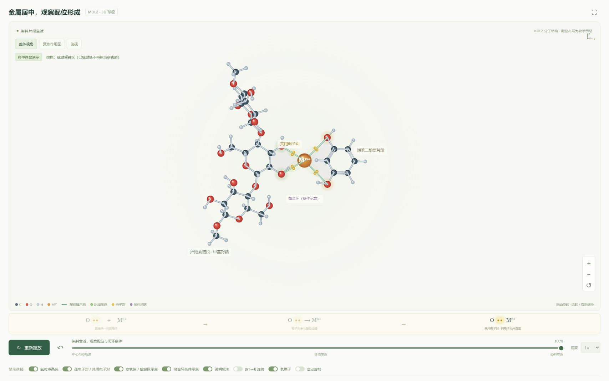

# 配位实验室

面向课堂的两组交互演示：

1. **铜配离子**：四水合铜(II)平面正方形教学模型，支持三维旋转、播放、暂停及进度控制。
2. **麻纤维与染料**：中心金属保持居中，纤维素链段先靠近，间苯二酚型染料片段随后靠近，支持三维旋转、缩放、氧位点高亮和 β(1→4) 连接标注。

## 直接使用

下载整个仓库，保持相对路径不变，双击 `index.html`，在顶部切换实验。也可以直接打开 `fiber.html` 进入麻纤维演示。核心功能无需联网或安装依赖。

本地 HTTP 预览可在该文件夹执行：

```sh
python -m http.server 8000
```

然后打开 `http://localhost:8000`。所有运行文件为纯静态网页，可用于静态网站托管。

## 课堂操作

- 点击三个阶段按钮，逐步讲解；或用播放、暂停和速度选择进行连续演示。
- 拖动进度条可停在任意中间步骤。
- 麻纤维页支持拖动旋转、滚轮缩放；手机支持单指旋转和双指缩放。
- “氧位点高亮”“孤电子对 / 共用电子对”“空轨道 / 成键区示意”“螯合环条件示意”“说明标注”“β(1→4) 连接”“氢原子”“自动旋转”可独立切换；另有整体、局部、俯视预设。
- 获得结构图键盘焦点后，方向键旋转，`+` / `−` 缩放，`0` 重置，空格播放或暂停。
- “课堂全屏”可用于投屏。页面底部的“教师说明与结构依据”列出模型范围。

## 科学范围

三维模型来自提供的两个 MOL2。麻纤维为三个糖环的甲基封端链段，72 个原子；间苯二酚为 14 个原子，芳环保持平面、羟基在 1,3 位。原纤维模型末端糖单元五个手性中心与标准纤维素构型相反，已保留原件并另存校正模型，详细记录见 SCIENCE.md 和 structures/mol2-verification.json。金属—氧实线表示条件教学模型中的配位键关系，不表示已经确定的配位数或螯合结构。

**游离间苯二酚不是本页已经明确的完整植物染料。** 本页以其结构表示参考图的含氧片段，不预测实际染色颜色。具体金属、完整染料、pH 等未指定，因此不补造唯一的配合物结构。

绿色区域只表示高中教学模型中的受体空轨道方向；相应位点成键后改称成键重叠区，不表示实际轨道形状或指定杂化类型。紫色螯合环仅表示同一配体两个位点同时结合于同一金属的条件，不确认本体系必然形成该结构。

更完整的结构来源和解释见 [SCIENCE.md](SCIENCE.md)。

## 文件

```text
index.html / app.js / style.css    铜配离子演示与公共样式
fiber.html / fiber-3d.js           MOL2 三维球棍演示
coordination-scene.js              固定金属与两侧片段的刚体运动布局
fiber.css / fiber-3d.css           麻纤维页样式
fiber.js                          先前二维演示代码（当前页面未使用）
navigation.css                    实验切换导航
structures/                       标准结构、SVG 和核对记录
tools/build_structures.py          先前二维结构生成脚本
tools/build_mol2_models.py          MOL2 检查、构型校正和三维数据导出
tools/check_coordination_scene.cjs 几何、手性与共用电子对核对（Node.js）
tools/requirements.txt             结构生成依赖
README.md / SCIENCE.md             使用与科学范围说明
preview.png                       麻纤维演示预览
```

网页本身没有第三方运行依赖。若需要重新生成分子 SVG，可安装 `tools/requirements.txt` 中的开发依赖，再执行 `python tools/build_mol2_models.py`。原始 MOL2 和校正模型均保留在 structures 中。网页运行不需要 Python。



电子对演示从氧旁的一对黄色标记过渡到金属—氧键区，突出同一对电子参与共用；下方特写同步标明电子对来源。左右分子朝向由保持手性的刚体旋转得到，纤维选取中间糖单元两个羟基氧（MOL2 IDs 23、24）以减少遮挡。
